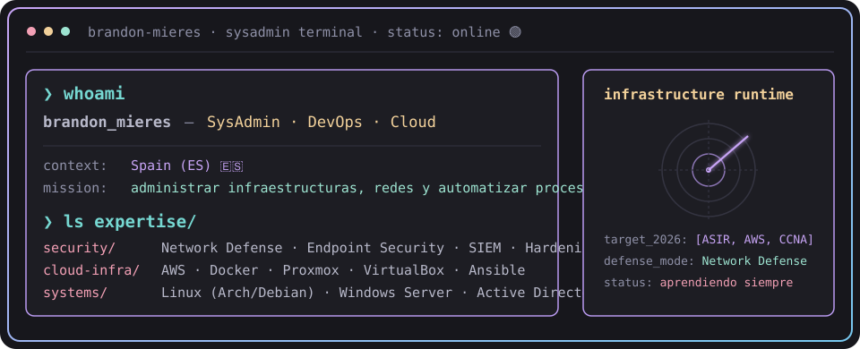



<!-- LOCAL ANIMATED BANNER (LIGHT/DARK) -->
<a href="https://github.com/BrandonMieres">
  <picture>
    <source media="(prefers-color-scheme: dark)" srcset="assets/banner-dark.svg">
    <source media="(prefers-color-scheme: light)" srcset="assets/banner-light.svg">
    
  </picture>
</a>

 

<!-- TYPING TERMINAL BANNER -->

 

---

## `$ whoami`

  

 

## `$ cat tech-stack.yaml`

<table border="1" cellpadding="14" bgcolor="#0d1628">
  <thead>
    <tr>
      <th colspan="2" align="left"><code>brandon-mieres:~$ cat tech-stack.yaml</code></th>
    </tr>
  </thead>
  <tbody>
    <tr>
      <td width="50%" valign="top"><code>├─ ☁ cloud_infrastructure:</code>  
        
         
        <code>AWS · Docker · Ansible · Linux · Proxmox · VirtualBox · Arch Linux</code>
      </td>
      <td width="50%" valign="top"><code>├─ 🔐 cybersecurity_pentesting:</code>  
        
        
        
        
         
        <code>Kali Linux · Wireshark · Burp Suite · Metasploit · Nmap</code>
      </td>
    </tr>
    <tr>
      <td valign="top"><code>├─ ⚙ devops_sysadmin:</code>  
         
         
        <code>Git · GitHub Actions · Nginx · Apache · WireGuard · Samba · BIND9 · SSH · PowerShell · Bash</code>
      </td>
      <td valign="top"><code>├─ ▣ databases_storage:</code>  
         
        <code>PostgreSQL · MySQL · MongoDB · Oracle PL/SQL · Active Directory</code>
      </td>
    </tr>
    <tr>
      <td valign="top"><code>├─ ✦ languages_frameworks:</code>  
         
        <code>Python · PHP · JavaScript · React · Next.js · Electron · Astro · HTML · CSS</code>
      </td>
      <td valign="top"><code>╰─ 🛡 security_frameworks:</code>  
        
        
        
         
        <code>Zero-Trust · Defense-in-Depth · SIEM · GPO · DNS · DHCP · IPv4/IPv6</code>
      </td>
    </tr>
  </tbody>
  <tfoot>
    <tr>
      <td colspan="2"><code>status: ready&nbsp;&nbsp;·&nbsp;&nbsp;environment: production&nbsp;&nbsp;·&nbsp;&nbsp;defense_mode: active</code></td>
    </tr>
  </tfoot>
</table>

---

## `$ nmap -sV security-signals`

  <picture>
    <source media="(prefers-color-scheme: dark)" srcset="assets/radar-dark.svg">
    <source media="(prefers-color-scheme: light)" srcset="assets/radar-light.svg">
    
  </picture>&nbsp;
  <picture>
    <source media="(prefers-color-scheme: dark)" srcset="assets/radar-langs-dark.svg">
    <source media="(prefers-color-scheme: light)" srcset="assets/radar-langs-light.svg">
    
  </picture>

<code>signals: security_devops_radar · language_stack_radar · status: healthy</code>

---

## `$ git log --oneline`

&nbsp;&nbsp;

  

 

<code>visibility: public + private · streak: maintained · repos: active</code>

---

## `$ cat credentials.json`

<table>
<tr>
<td width="50%" valign="top">

### 🎓 Formación Académica

**🎓 Técnico Superior en ASIR**  
Administración de Sistemas Informáticos en Red  
*Universitat Oberta de Catalunya (UOC), Barcelona* · `2024 – 2026`

> Administración de sistemas operativos, redes, servicios de red e Internet, bases de datos, seguridad y alta disponibilidad.

 

**💻 Técnico en SMR**  
Sistemas Microinformáticos y Redes  
*INS Freta, Calella, España* · `2020 – 2022`

> Montaje, mantenimiento de sistemas informáticos, redes locales cableadas e inalámbricas y soporte especializado.

 

### 💼 Experiencia

**🖥️ Técnico de Sistemas y Soporte** *(Prácticas)*  
*Freta, Calella* · `2021 – 2022`

- Diagnóstico y resolución de incidencias en equipos y sistemas
- Mantenimiento de servidores, redes y bases de datos
- Soporte técnico a usuarios y optimización de rendimiento

</td>
<td width="50%" valign="top">

### 🏆 Certificaciones

**🔐 Cisco Networking Academy** · `2025`

 

**☁️ AWS Academy** · `2024`

 

**🗄️ Oracle Academy** · `2026`

 

**🤖 Elements of AI** · `2026`

 

🔗 Verificables en <a href="https://credly.com/users/brandon-mieres/badges">Credly → brandon-mieres</a>

</td>
</tr>
</table>

---

## `$ ls -la featured-projects/`

&nbsp;&nbsp;

 

&nbsp;&nbsp;

 

 

<code>📌 ShadowBox es el TFG de ASIR (coautoría) · Flask · Ansible · React</code>

---

## `$ connect --socials`

&nbsp;&nbsp;
&nbsp;&nbsp;
&nbsp;&nbsp;

  

<picture>
  <source media="(prefers-color-scheme: dark)" srcset="https://raw.githubusercontent.com/platane/platane/output/github-contribution-grid-snake-dark.svg">
  <source media="(prefers-color-scheme: light)" srcset="https://raw.githubusercontent.com/platane/platane/output/github-contribution-grid-snake.svg">
  
</picture>

  

🔒 <em>"En un mundo interconectado, la seguridad no es una opción, es una responsabilidad."</em> · Brandon Mieres · Terrassa 🇪🇸

